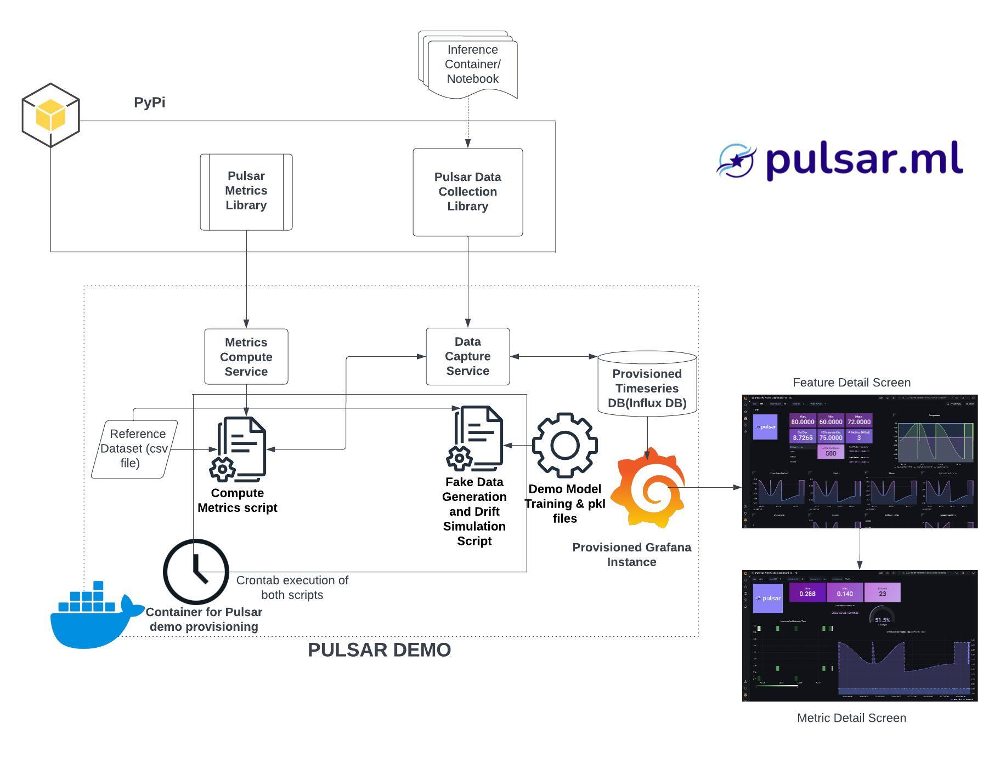
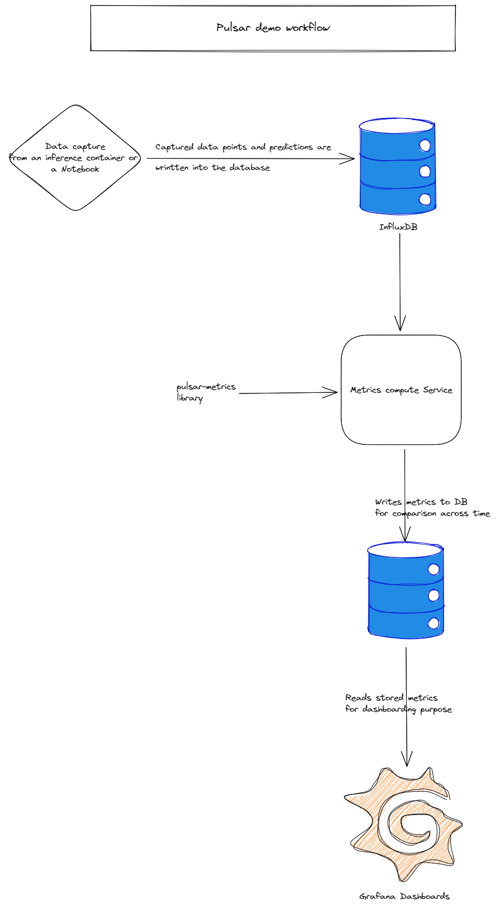

# Pulsar.ML Demo

A comprehensive ML monitoring and drift detection demo showcasing real-time model performance tracking using [pulsar-data-collection](https://github.com/Rocket-Science-Development/pulsar_data_collection) and [pulsar-metrics](https://github.com/Rocket-Science-Development/pulsar_metrics).

## 🚀 Quick Start

### Prerequisites
- **Docker**: 20.10.0+ with Docker Compose 2.0+
- **System Requirements**: 4GB RAM, 2GB free disk space
- **Supported OS**: Linux, macOS, Windows with WSL2

### 5-Minute Setup

1. **Clone and Configure**
   ```bash
   git clone https://github.com/Rocket-Science-Development/pulsar_demo.git
   cd pulsar_demo
   cp .env.example .env  # Optional: customize credentials
   ```

2. **Launch Services**
   ```bash
   docker-compose up --build
   ```

3. **Access Dashboard**
   - **Grafana**: http://localhost:3000 (admin/pass123)
   - **InfluxDB Admin**: http://localhost:8889
   - Wait 2-5 minutes for initial data generation

### Verify Installation
```bash
# Check all services are running
docker-compose ps

# Monitor logs
docker-compose logs -f
```

## 📊 Available Services
| Service | URL | Purpose | Default Credentials |
|---------|-----|---------|-------------------|
| **Grafana** | http://localhost:3000 | ML Monitoring Dashboards | admin/pass123 |
| **Chronograf** | http://localhost:8889 | Database Management UI | - |
| **InfluxDB** | http://localhost:8086 | Time-series Data Storage | admin/pass123 |

## 🏗️ System Architecture



### Data Flow Overview



**Automated ML Monitoring Pipeline**:

1. **Data Generation** (every 2 min): Simulates ML inference with configurable drift patterns
2. **Data Collection**: Captures predictions and metadata using `pulsar-data-collection`
3. **Metrics Computation** (every 4 min): Calculates drift and performance metrics via `pulsar-metrics`
4. **Real-time Visualization**: Displays metrics in Grafana dashboards with alerting

### Core Components
- **Fake Data Generator**: Synthetic data with drift simulation
- **Metrics Engine**: Automated drift detection and performance tracking
- **Time-Series Storage**: InfluxDB for prediction and metrics data
- **Monitoring Dashboard**: Grafana with pre-configured ML monitoring views

## 📚 Comprehensive Documentation

Detailed documentation is available in the `docs/` folder:

| Topic | Description | Link |
|-------|-------------|------|
| **Installation** | Detailed setup with prerequisites and verification | [docs/setup/installation.md](docs/setup/installation.md) |
| **Troubleshooting** | Common issues, log analysis, and solutions | [docs/troubleshooting/common-issues.md](docs/troubleshooting/common-issues.md) |
| **Architecture** | System components and data flow details | [docs/architecture/overview.md](docs/architecture/overview.md) |
| **Security** | Credential management and security best practices | [docs/security/guidelines.md](docs/security/guidelines.md) |
| **Development** | Customization guides and development workflow | [docs/development/getting-started.md](docs/development/getting-started.md) |
| **API Reference** | Data collection API and configuration options | [docs/api/data-collection.md](docs/api/data-collection.md) |

## 🛠️ Customization

### Adding Custom Metrics
```python
@CustomMetric
def my_business_metric(current, reference, **kwargs):
    # Your custom metric logic
    return calculated_value
```

### Configuring Drift Patterns
```python
DRIFT_CONFIG = {
    'intensity': DriftIntensity.MODERATE,
    'pattern': 'seasonal',  # or 'gradual', 'sudden'
    'features_affected': ['age', 'balance']
}
```

### Environment Configuration
```bash
# Custom credentials
export GRAFANA_PASSWORD=your_secure_password
export DB_PASSWORD=your_db_password

# Drift simulation settings  
export DRIFT_INTENSITY=HIGH
export SAMPLE_SIZE=2000
```

## 🚨 Troubleshooting Quick Fixes

**Services won't start?**
```bash
docker-compose down -v && docker-compose up --build
```

**No data in dashboards?**
```bash
docker-compose logs fake-data-generator compute-metrics
# Wait 5 minutes for initial data generation cycle
```

**Connection issues?**
```bash
# Check all services are running
docker-compose ps
# Verify ports are not in use
sudo netstat -tlnp | grep -E '3000|8086|8889'
```

## 📖 About Pulsar.ML

[Pulsar.ML](https://pulsar.ml/) provides comprehensive ML model monitoring and observability tools.

### Open Source Packages
- **[pulsar-data-collection](https://github.com/Rocket-Science-Development/pulsar_data_collection)**: Lightweight Python SDK for capturing ML predictions and metadata
- **[pulsar-metrics](https://github.com/Rocket-Science-Development/pulsar_metrics)**: Advanced drift detection and performance monitoring library

### Community & Support
- **Issues & Support**: [GitHub Issues](https://github.com/Rocket-Science-Development/pulsar_demo/issues)
- **Company**: Powered by [Rocket Science Development](https://rocketscience.one/)

## 🤝 Contributing

We welcome contributions! Here's how to get started:

1. **Fork** this repository
2. **Create** a feature branch: `git checkout -b feature/amazing-feature`
3. **Commit** your changes: `git commit -m 'Add amazing feature'`
4. **Push** to branch: `git push origin feature/amazing-feature`
5. **Open** a Pull Request with detailed description

**Development Setup**:
```bash
# Install dependencies
poetry install  # or pip install -r requirements.txt

# Run tests
pytest tests/

# Code formatting
black src/ && isort src/
```

**Areas for Contribution**:
- Additional drift detection algorithms
- New visualization dashboards  
- Enhanced security features
- Performance optimizations
- Documentation improvements
