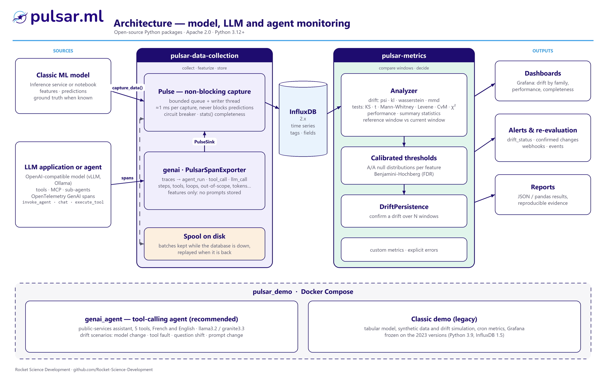
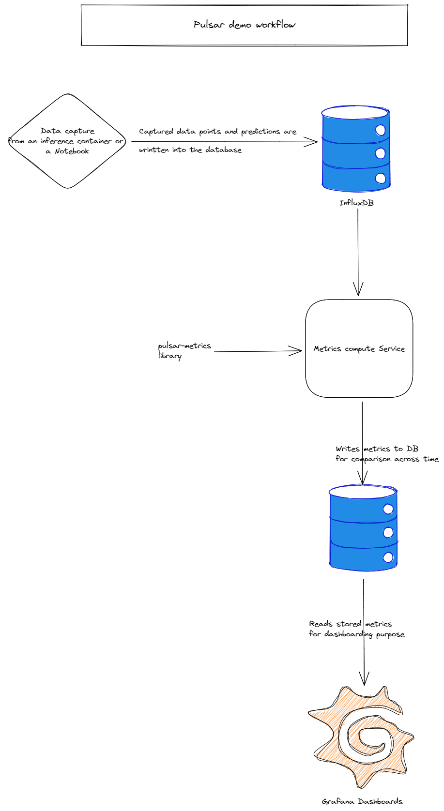

<p align="center"></p>

# Pulsar.ml demos

Ready-to-run examples showing how [pulsar-data-collection](https://github.com/Rocket-Science-Development/pulsar_data_collection)
and [pulsar-metrics](https://github.com/Rocket-Science-Development/pulsar_metrics) monitor machine learning models,
LLM applications and agents in production: collect the data without slowing the service down, store it in InfluxDB,
then detect data drift, concept drift and performance degradation with calibrated thresholds.



## Demos

| Demo | What it shows | Stack | Status |
|---|---|---|---|
| [**`genai_agent/`**](genai_agent/README.md) | A tool-calling agent (public-services assistant, 5 tools, French and English) monitored through OpenTelemetry GenAI: agent runs, tool calls and LLM calls, with drift scenarios (model change, tool fault, question shift, prompt change) | Python 3.12+, pulsar-data-collection ≥ 0.5, pulsar-metrics ≥ 0.5, InfluxDB 2.6, Ollama (llama3.2, granite3.3) | **Recommended** |
| Classic demo (repository root) | A tabular model with synthetic data and simulated drift; metrics computed on a schedule and shown in Grafana | Python 3.9, pulsar-data-collection 0.1.1 and pulsar-metrics 0.1.3 from PyPI, InfluxDB 1.5 | Legacy, frozen on the 2023 versions |

## Quick start: agent demo

```bash
cd genai_agent
docker compose up -d                                   # InfluxDB 2.6.1 and Ollama
docker compose exec ollama ollama pull llama3.2:3b     # ~2.0 GB

export INFLUX_URL=http://localhost:8086 INFLUX_TOKEN=demo-token-change-me INFLUX_BUCKET=monitoring
uv run python run_agent.py --runs 20                   # reference traffic
uv run python run_agent.py --runs 20 --timeout-rate 0.3 --label tool_fault   # a degraded tool
```

See [`genai_agent/README.md`](genai_agent/README.md) for the scenarios, the stored fields and how to query them.
On a laptop CPU one agent run takes 20 to 60 s; point `LLM_BASE_URL` to a GPU-backed OpenAI-compatible endpoint
(vLLM, Ollama) for larger studies.

## What the architecture does

1. **Collect.** A classic model calls `Pulse.capture_data()`; an LLM application or an agent emits OpenTelemetry GenAI
   spans (`invoke_agent`, `chat`, `execute_tool`) that `PulsarSpanExporter` turns into agent-run, tool-call and
   LLM-call records. Capture is non-blocking (about 1 ms): a slow or unavailable database never slows predictions down,
   and batches are kept on disk until it is back. Only features are stored, never prompts or answers.
2. **Store.** Records go to InfluxDB 2.x, tagged by model, version and record type.
3. **Analyze.** `pulsar-metrics` compares a reference window with the current window: distances (PSI, KL,
   Wasserstein, MMD), statistical tests (KS, t, Mann-Whitney, Levene, Cramér-von Mises, χ²), performance metrics.
   Thresholds are calibrated on A/A draws, corrected for multiple testing (Benjamini-Hochberg), and a drift is
   confirmed only when it persists over several windows.
4. **Act.** Results feed dashboards, alerts and reports.

## Classic demo (legacy)

Kept for reference. It relies on the 2023 releases of both packages (PyPI, Python 3.9) and on InfluxDB 1.5, and does
not use the current APIs.

```bash
# set your own values; do not reuse these names as passwords
export GRAFANA_USERNAME=admin GRAFANA_PASSWORD=<choose-a-password>
export DB_USER=admin DB_PASSWORD=<choose-a-password>
docker compose up --build
```

Then open Grafana on http://localhost:3000 with the credentials above.



1. Data is captured from an inference container or a notebook with pulsar-data-collection.
2. Data points, predictions and metadata are written to InfluxDB.
3. The `compute-metrics` service reads the latest entries and computes the metrics with pulsar-metrics on a schedule.
4. The metrics are written back to InfluxDB and displayed in Grafana.

## Regenerating the architecture diagram

```bash
python images/draw_architecture.py images        # requires Pillow; see the script for fonts
```

## About [Pulsar.ml](https://pulsar.ml/)

Pulsar.ml helps monitor machine learning models, LLM applications and agents in production. It is made of two
open-source packages:

- [pulsar-data-collection](https://github.com/Rocket-Science-Development/pulsar_data_collection): collects features,
  predictions, metadata and agent traces (OpenTelemetry GenAI) without slowing the service down.
- [pulsar-metrics](https://github.com/Rocket-Science-Development/pulsar_metrics): data drift, concept drift and
  performance metrics with calibrated thresholds.

Powered by [Rocket Science Development](https://rocketscience.one/).

## Contributing

1. Open an issue describing the change.
2. Fork the repository, develop on a branch, and test your changes.
3. Submit a pull request referencing the issue.
