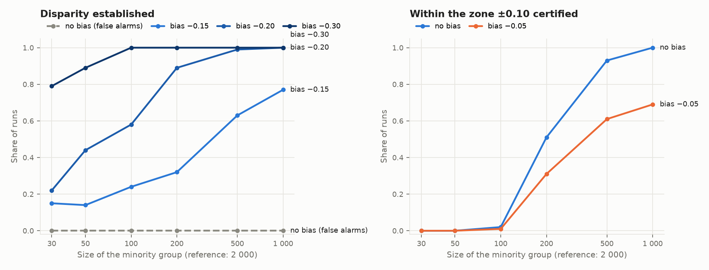
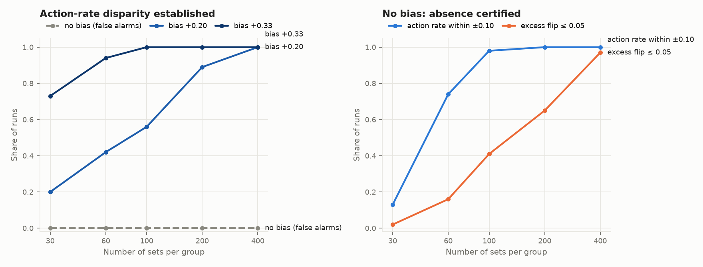
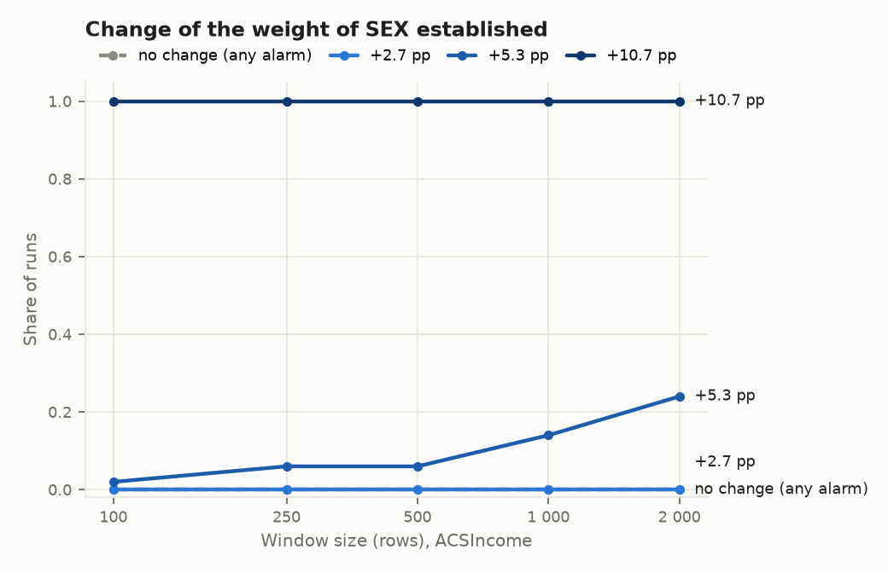
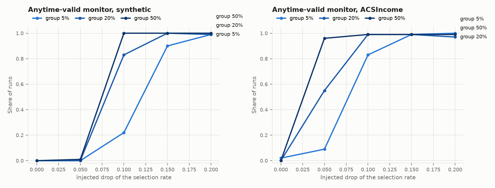

# Validation of the ethics and bias modules of Pulsar.ml

Reproducible validation of the fairness and explainability modules of
[pulsar-metrics](https://github.com/Rocket-Science-Development/pulsar_metrics) and of the counterfactual probes of
[pulsar-data-collection](https://github.com/Rocket-Science-Development/pulsar_data_collection). The method is always the
same: inject a bias of known size, then measure, by sample size, how often each module **establishes** it (power) and
how often it raises an alarm when there is none (false alarms).

| File | Role |
|---|---|
| `synthetic_eligibility.py` | Semi-synthetic eligibility decisions with Canadian synthetic attributes (official language, region, age group) and a bias injected on purpose. No real person. |
| `power_curves.py` | Power and false-alarm simulations: fixed fairness analysis, counterfactual probe, explanation drift (ACSIncome) |
| `plots.py` | Figures (one line per injected bias, false alarms dashed gray) |
| `export_results.py` | All results as `MetricResults` JSON Lines with their provenance, for the governance layer |

```bash
pip install "pulsar-metrics[explain] @ git+https://github.com/Rocket-Science-Development/pulsar_metrics.git" \
            "pulsar-data-collection @ git+https://github.com/Rocket-Science-Development/pulsar_data_collection.git" \
            matplotlib folktables
python power_curves.py --experiments fixed probe --out results          # about 5 minutes
python power_curves.py --experiments explain --data-dir /path/to/folktables --out results
python plots.py --results results --sequential-json bench_synthetic.json bench_folktables.json
python export_results.py --out results/metric_results.jsonl --probe-rows probe_biased_rows.csv
```

- The sequential-monitor curves come from the bias-injection bench of pulsar-metrics
  (`benchmarks/fairness_drift.py`), and the probe rows from `genai_agent/probe_agent.py`.
- The ACSIncome files (Folktables, census microdata) are downloaded once and kept outside any repository.

## Results

`results/` holds the JSON of every curve. The figures are in `results/fig_*.png`.

**Fixed analysis**: `FairnessAnalyzer`, demographic parity difference, acceptable zone [-0.1, 0.1], reference group of
2,000 rows. A bias is established only when the interval lies entirely outside the zone.



**Counterfactual probe**: rate of an action, zone [-0.1, 0.1]; excess flip rate over the placebo, tolerance 0.05.



**Explanation drift**: the share of `SEX` in the TreeSHAP attributions on ACSIncome, when part of the window comes
from a model retrained on labels biased against women.



**Anytime-valid monitor**: power by injected drop and by share of the monitored group in the stream.


